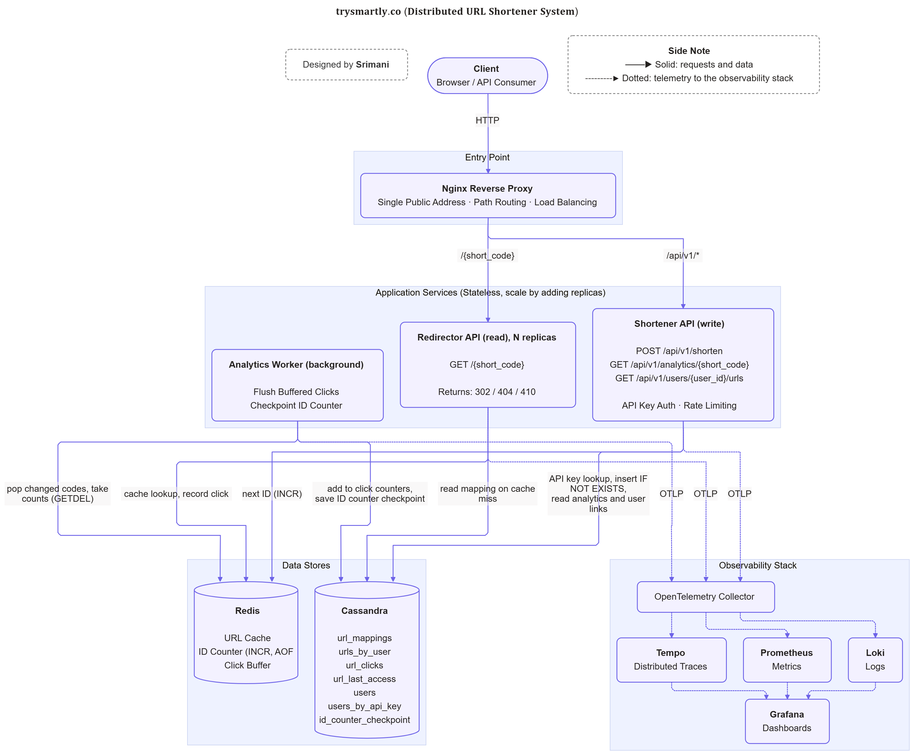

<p align="center"></p>

|Before you begin| |
|---|---|
| **Written by** | Me, by hand. Short on purpose, so you read at least this page fully |
| **Written for** | Reviewers who have <5 minutes |
| **Kept short by** | Tables, links to full docs, no filler |
| **Gaps** | Stated openly, not hidden |

# URL Shortener Service (trysmartly.co)

A URL shortener I built to answer one question: **how do you build a URL shortener that keeps redirecting even when its cache, database, or servers fail?** Not to replace bit.ly.

If you're reviewing this as a hiring manager, architect, or senior engineer: this README is for you.

## Start Here..

A one-page guide. Each table links to the full document.

### 1. Requirements and Scope ([full](docs/01-requirements/requirements.md))

| Area | In scope | Target |
|---|---|---|
| Links | Shorten, custom alias, expiry (default and custom TTL) | 7-char Base62 codes, no collisions |
| Redirect | `302` to the original URL | p99 < 50 ms |
| Analytics | Click count per link | No clicks lost |
| Accounts | Email sign-up, API key, rotate key, delete account | Keys stored as hashes only |
| Web UI | Sign in, create and list links, view stats | Angular app under `/app/` |
| Availability | Redirects survive cache, DB and replica failures | 99.99% (designed, not tested) |
| Scale | 10M new links/day, 100:1 reads to writes | 35,000 redirects/s peak, 5.5 TB in 5 years |

### 2. High-Level Design ([full](docs/02-design/architecture.md))

[](docs/02-design/architecture.md)

| Component | Role |
|---|---|
| Nginx | Single entry point, routes by path, load balances |
| Shortener API | Write path: create links, accounts, analytics queries |
| Redirector API | Read path: resolve short code, record click in Redis |
| Analytics Worker | Flush clicks from Redis to Cassandra, checkpoint ID counter |
| Cassandra | Source of truth: links, users, click counts |
| Redis | Cache, ID counter, click buffer |
| Web UI | Angular single-page app |

### 3. Tech and Design Choices ([full](docs/02-design/tech-decisions.md))

| Decision | Choice | Why |
|---|---|---|
| Database | Cassandra | Key lookups at 100:1 reads, 5.5 TB, built-in TTL |
| Schema | One table per query | No joins, one partition read per question |
| Cache and counter | Redis | Memory-speed reads, atomic `INCR`, no locks |
| Short code | Counter, keyed permutation, Base62 | Unique by construction, not guessable |
| Click counting | Redis buffer, batched flush | Redirect stays fast, one write per batch |
| Entry point | Nginx | Scale reads and writes separately |
| Authentication | Hashed API keys | Simple and safe for machine callers |
| Observability | OpenTelemetry + Grafana | Prove the p99 target, catch silent failures |

## Tech Stack..

**Backend**


**Frontend**


**Deployment**


**Observability**


**Testing**


## Why I Built This..

Most shorteners are a hash and a table. The hard questions only show up in production:

* How do two servers hand out short codes at the same time and never produce the same one, without a lock?
* What happens to redirects when Redis dies? When Cassandra restarts? When a replica is killed mid-traffic?
* How do you count a billion clicks without making the redirect itself slower?
* How do you *prove* "p99 under 50 ms" instead of just writing it in a requirements doc?

I wanted measured answers, not diagrams. So I built it, broke it on purpose, and wrote down what happened.

## What I Was Solving For..

| Problem | Approach | Result |
|---|---|---|
| **Unique, unguessable codes** | Redis counter + keyed permutation + Base62 | No collisions by construction; 400 links gave 400 distinct codes |
| **Counter lost or reset** | AOF persistence + Cassandra checkpoint + re-seed ahead on startup | Old codes are never re-issued after a reset |
| **Redis goes down** | Cache in front of Cassandra, fast-fail connections | Redirects keep working (`302`); only shortening returns `503` |
| **Clicks slowing redirects** | Cheap Redis writes, a worker batches them to Cassandra | Cassandra stopped mid-traffic, zero clicks lost |
| **A replica dies** | Stateless redirectors behind Nginx | One of 3 stopped, 300 of 300 redirects still succeeded |
| **Proving the latency target** | OpenTelemetry + Grafana | p99 **42.7 ms**, p50 3.4 ms |

## What's in the Codebase..

* Three services: Shortener (write), Redirector (read), Analytics Worker, plus Nginx as the single entry point
* Cassandra schema modelled query-first (one table per question), Redis for cache, counter and click buffer
* API-key authentication (only a hash is stored) and per-user token-bucket rate limiting
* Health checks, JSON structured logs, OpenTelemetry, a provisioned Grafana dashboard
* 296 automated tests, 15 end-to-end scenarios (58 checks) including three disruptive ones that stop real containers
* One-command developer scripts and a GitHub Actions pipeline

## Where to Read More..

| If you want to know... | Read |
|---|---|
| Request flows, APIs, schema and deep dives | [docs/02-design/design.md](docs/02-design/design.md) |
| How it was built, phase by phase, with deviations and results | [docs/03-implementation/implementation-plan.md](docs/03-implementation/implementation-plan.md) |
| Every requirement checked against evidence, and the gaps | [Phase 11 of the plan](docs/03-implementation/implementation-plan.md#phase-11--verification-against-requirements) |
| The dev scripts and scenarios | [scripts/](scripts/) |

## What I Chose Not to Build..

Left out on purpose:

* CDN
* `301` redirects
* User sign-up
* Distributed rate limiting
* Multi-node Cassandra and Redis
* Editing or deleting links
* Malicious-URL checks
* Bot filtering

What I did **not** prove:

* 99.99% availability and 35,000 redirects per second are goals for a multi-node setup. v1 runs one node of each, so these are designed for, not tested.
* The p99 figure was measured on one laptop that also ran the load generator, so it is close to the limit. The plan says the same.

## "Did AI write this?"

Yes, mostly. I used Claude via Github Copilot as a pair programmer. The ***requirements, design and technology choices are mine***; Copilot wrote most of the code, tests and scripts.

You don't have to trust me on it: every phase in the plan records what was built, what changed and how it was verified.

> The skill that mattered most was deciding **knowing what not to build**.

## Try It..

Needs Docker and PowerShell (5.1 or 7+).

```powershell
./scripts/Start-Dev.ps1 -Build -Scale 3          # whole stack behind Nginx, 3 redirector replicas
./scripts/Invoke-Scenario.ps1 -All -IncludeDisruptive   # watch it survive being broken
```

<p align="center"><strong>© 2026 Srimani. All rights reserved.</strong></p>
