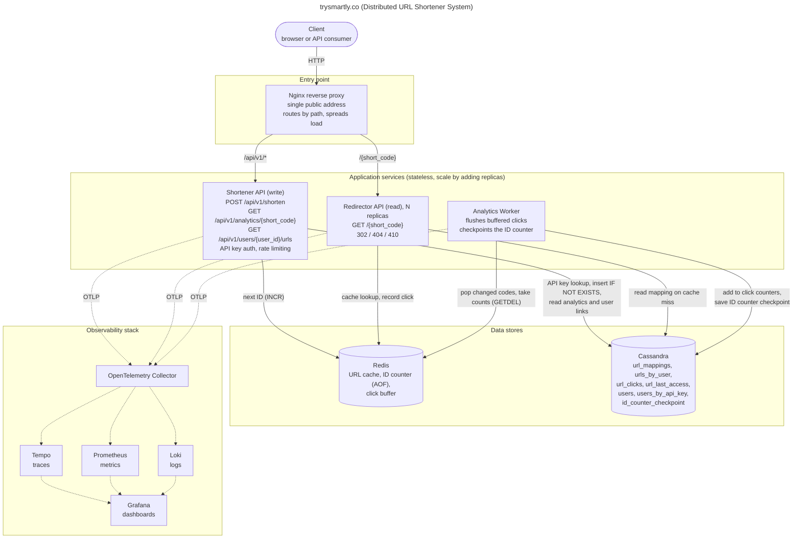

# Architecture

The complete picture of the system on one page. Solid arrows carry requests and data; dotted arrows carry telemetry to the observability stack.

Table definitions, relationships and Redis keys for the data stores are in [db-schema.md](db-schema.md).

## Services

| Service | Responsibility |
|---|---|
| Load Balancer (Nginx) | Single entry point; path-based routing; load balancing |
| Shortener API (write) | `POST /api/v1/shorten`, `GET /api/v1/analytics/{short_code}`, `GET /api/v1/users/{user_id}/urls` |
| Redirector API (read) | `GET /{short_code}`, records clicks in Redis |
| Analytics Worker | Flushes buffered clicks from Redis to Cassandra; checkpoints the ID counter |

## Where to go next

* Request flows, APIs and deep dives: [design.md](design.md)
* Cassandra tables and Redis keys behind the data stores above: [db-schema.md](db-schema.md)
* Why each technology was chosen: [tech-decisions.md](tech-decisions.md)
