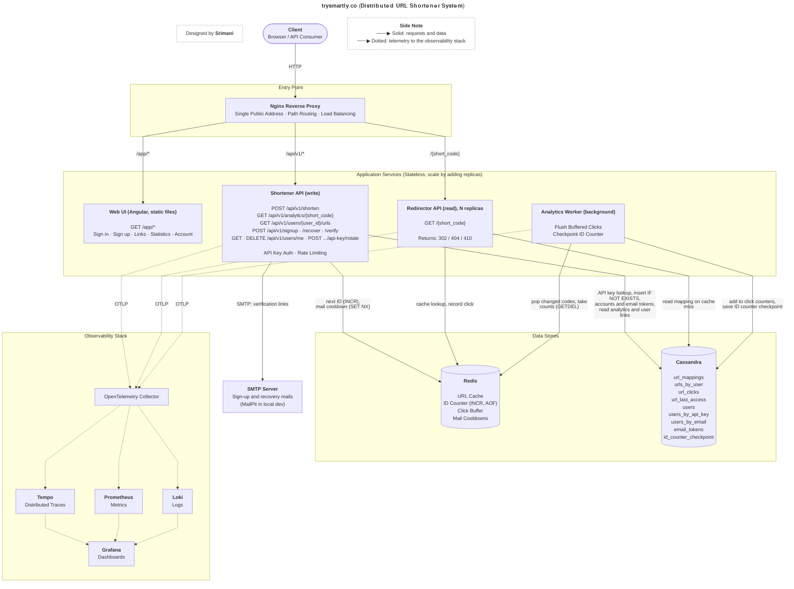

# Architecture

The complete picture of the system on one page. Solid arrows carry requests and data; dotted arrows carry telemetry to the observability stack.

Table definitions, relationships and Redis keys for the data stores are in [db-schema.md](db-schema.md).

## Services

| Service | Responsibility |
|---|---|
| Load Balancer (Nginx) | Single entry point; path-based routing (`/app/*`, `/api/v1/*`, `/{short_code}`); load balancing |
| Web UI (Angular) | Static single-page app under `/app/`: sign in with an API key, sign up and recover by email, create and list links, view statistics, replace the key, delete the account |
| Shortener API (write) | Links: `POST /api/v1/shorten`, `GET /api/v1/analytics/{short_code}`, `GET /api/v1/users/{user_id}/urls`. Accounts: `POST /api/v1/signup`, `/recover`, `/verify`, `GET` and `DELETE /api/v1/users/me`, `POST /api/v1/users/me/api-key/rotate` |
| Redirector API (read) | `GET /{short_code}`, records clicks in Redis |
| Analytics Worker (background) | Flushes buffered clicks from Redis to Cassandra; checkpoints the ID counter |
| SMTP Server | Delivers the sign-up and key recovery mails (MailPit catches them in local development) |

## Where to go next

* Request flows, APIs and deep dives: [design.md](design.md)
* Cassandra tables and Redis keys behind the data stores above: [db-schema.md](db-schema.md)
* Why each technology was chosen: [tech-decisions.md](tech-decisions.md)
