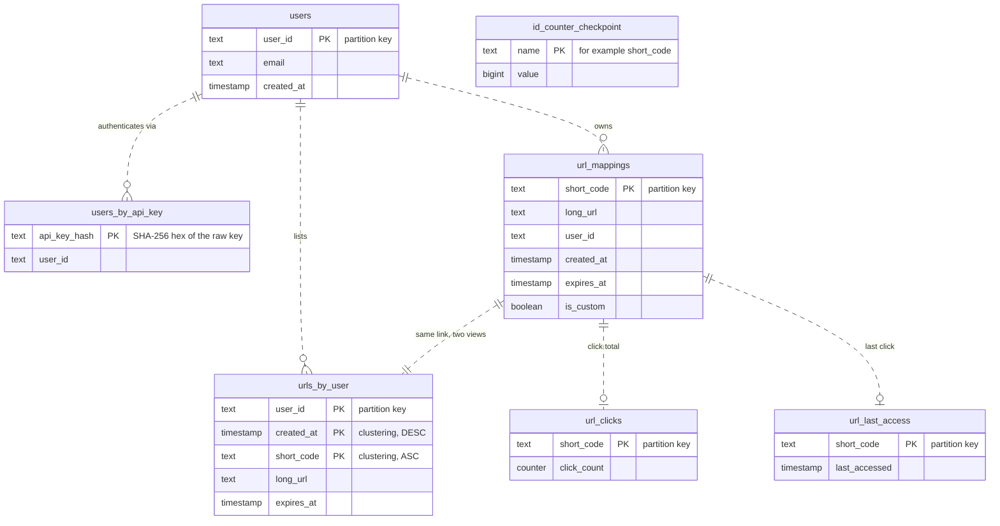
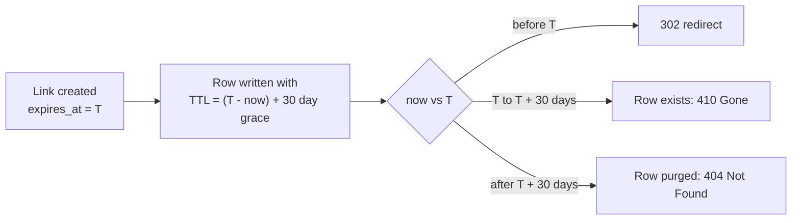
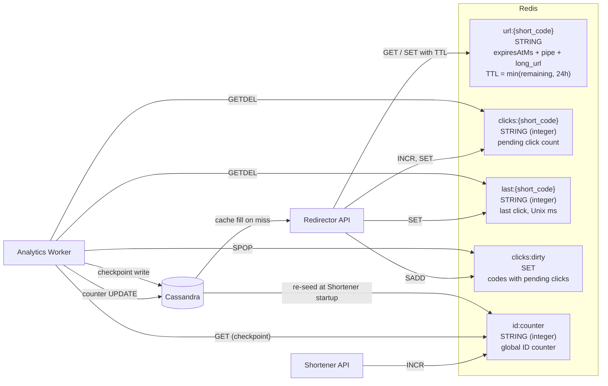
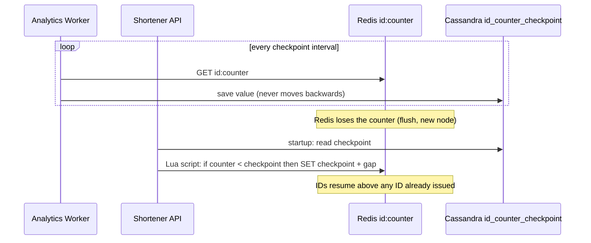

# Data Design: Cassandra and Redis Schema

Companion to [design.md](design.md) (section 3) and [architecture.md](architecture.md). Source of truth for the definitions: [schema.cql](../../deploy/cassandra/schema.cql) and [RedisKeys.cs](../../src/UrlShortener.Infrastructure/Redis/RedisKeys.cs).

Cassandra is the **system of record**. Redis holds **disposable or rebuildable state**: a read cache, a click buffer, and the ID counter.

## 1. Cassandra (keyspace `urlshortener`)

Cassandra is modelled query-first: one table per access pattern, data denormalized across tables, no joins, no secondary indexes. The lines in the diagram are **logical** relationships only; Cassandra does not enforce foreign keys.

### 1.1 Access patterns

| # | Query | Table | Key used | Served by |
|---|---|---|---|---|
| 1 | Resolve a short code to its destination | `url_mappings` | `short_code` | Redirector (cache miss) |
| 2 | Claim a code or alias atomically | `url_mappings` | `INSERT ... IF NOT EXISTS` | Shortener |
| 3 | List a user's links, newest first | `urls_by_user` | `user_id`, then clustering order | Shortener |
| 4 | Authenticate an API key | `users_by_api_key` | `api_key_hash` | Shortener |
| 5 | Read click statistics | `url_clicks`, `url_last_access` | `short_code` | Shortener |
| 6 | Add flushed clicks | `url_clicks`, `url_last_access` | `short_code` | Analytics Worker |
| 7 | Save or load the ID counter high-water mark | `id_counter_checkpoint` | `name` | Analytics Worker, startup of Shortener |

### 1.2 Table notes

**`url_mappings`** (redirect path)
- Partition key is `short_code`, so a redirect is a single-partition read.
- Custom aliases and generated codes share this key space. `is_custom` only records which kind it is.
- Created with `INSERT ... IF NOT EXISTS USING TTL n` (a lightweight transaction). If it is not applied, a custom alias returns `409`; a generated code fetches a new ID and retries.
- `expires_at` is always set (default 1 year).
- `click_count` is **not** here: Cassandra forbids counter columns alongside regular columns.

**`urls_by_user`** (list a user's links)
- Replaces a secondary index on `user_id`.
- Clustering `created_at DESC, short_code ASC` gives newest-first paging; `short_code` is the tie-breaker for links created in the same millisecond.
- Written together with `url_mappings` using the same TTL. `long_url` and `expires_at` are copied so the list needs no second lookup.
- A user with millions of links makes one large partition; acceptable for v1 (paged reads).

**`url_clicks`**
- Counter table. Counter updates are not idempotent and the table does not support TTL, so rows of expired links remain (accepted for v1).

**`url_last_access`**
- Kept separate from `url_clicks` because counter tables cannot hold regular columns.

**`users` / `users_by_api_key`**
- Two tables for two lookups: `users` by id, `users_by_api_key` by key hash.
- Only the lowercase-hex SHA-256 of the API key is stored; the raw key never reaches the database.

**`id_counter_checkpoint`**
- One row per counter (`name = 'short_code'`). If Redis loses the counter, it is re-seeded to `value + safety gap` (see section 2.3).

### 1.3 TTL and expiry

- The grace period lets the redirector tell "expired" (`410`) apart from "never existed" (`404`).
- Maximum TTL is 20 years (630,720,000 s). Cassandra 5.0 also needs `storage_compatibility_mode: NONE` for TTLs that end after 2038; the compose file sets it.

### 1.4 Local vs production

`schema.cql` uses `SimpleStrategy` with replication factor 1 for local development. Production should use `NetworkTopologyStrategy` with RF 3 per data center.

## 2. Redis

Redis holds no data that cannot be rebuilt or tolerated lost, except the ID counter, which is protected by AOF and the Cassandra checkpoint. All key names come from `RedisKeys`; an optional `Redis:KeyPrefix` (empty by default) is prepended to every key.

### 2.1 Key catalogue

| Key pattern | Type | Value | TTL | Written by | Read / removed by |
|---|---|---|---|---|---|
| `url:{short_code}` | String | `{expiresAtUnixMs}\|{longUrl}` | `min(remaining lifetime, 24h)` | Redirector (on cache miss) | Redirector |
| `clicks:{short_code}` | String (int) | Clicks since the last flush | none | Redirector (`INCR`), Worker (restore with `INCRBY`) | Worker (`GETDEL`) |
| `last:{short_code}` | String (int) | Last click, Unix ms | none | Redirector, Worker (restore, only if absent) | Worker (`GETDEL`) |
| `clicks:dirty` | Set | Short codes with pending clicks | none | Redirector (`SADD`), Worker (restore) | Worker (`SPOP` in batches) |
| `id:counter` | String (int) | Last issued ID | none | Shortener (`INCR`, re-seed script at startup) | Worker (checkpoint read) |

### 2.2 Notes per key

**`url:{short_code}`** (read cache)
- Cache-aside: the redirector reads Redis, falls back to Cassandra, then fills Redis in the background.
- The value is `expiresAtMs|longUrl`, not JSON. Only the first `|` separates the fields, so URLs containing `|` are safe. An unparsable value is treated as a miss.
- TTL is `min(link.remaining_lifetime, 24h)` so a cached entry can never outlive the link. A zero or negative TTL is not cached.
- If Redis is down, reads behave as a miss and redirects continue from Cassandra.

**`clicks:{short_code}`, `last:{short_code}`, `clicks:dirty`** (click buffer)
- A click runs `INCR clicks:{code}`, `SADD clicks:dirty {code}` and `SET last:{code}` in one batched round trip, off the redirect's critical path.
- The worker flushes on an interval: `SPOP clicks:dirty n`, then `GETDEL` on both keys for each code, then a Cassandra counter update.
- `GETDEL` is atomic, so a click arriving mid-flush starts a fresh counter instead of being lost.
- On a Cassandra failure the worker puts the count back with `INCRBY`, re-adds the code to `clicks:dirty`, and restores `last:` only if no newer click set it.
- Known limit: a crash between `GETDEL` and the Cassandra write can lose clicks, and a retry after a partial write can double-count a few. Accepted for v1.
- If Redis is down, the click is dropped; a lost click is preferred over a slow redirect.

**`id:counter`** (ID generator)
- `INCR` is atomic, so no two callers receive the same ID. The ID then goes through the 40-bit Feistel permutation and Base62 encoding to become the short code.

### 2.3 Counter durability

Layers of protection:
1. Redis runs with AOF (`appendonly yes`, `appendfsync everysec`).
2. The checkpoint in Cassandra lets the counter be re-seeded to `checkpoint + safety gap` (for example 100,000). The compare-and-set runs as a Lua script, so two services starting together cannot both reseed.
3. Every `url_mappings` insert uses `IF NOT EXISTS`; a collision fetches a new ID and retries (bounded).

## 3. Who owns what

| Data | Store | Writer | Loss impact |
|---|---|---|---|
| Links, users, API keys | Cassandra | Shortener | Permanent loss; the system of record |
| Click totals, last access | Cassandra | Analytics Worker | Permanent loss |
| Counter checkpoint | Cassandra | Analytics Worker | Reseed falls back to the Redis value |
| Destination cache `url:` | Redis | Redirector | None; refilled on demand |
| Pending clicks `clicks:`, `last:`, `clicks:dirty` | Redis | Redirector | Up to one flush interval of clicks |
| ID counter `id:counter` | Redis | Shortener | Recoverable from the checkpoint plus gap |
