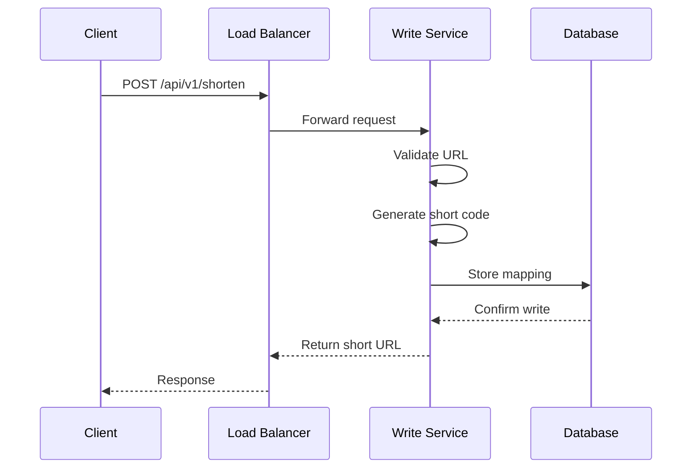
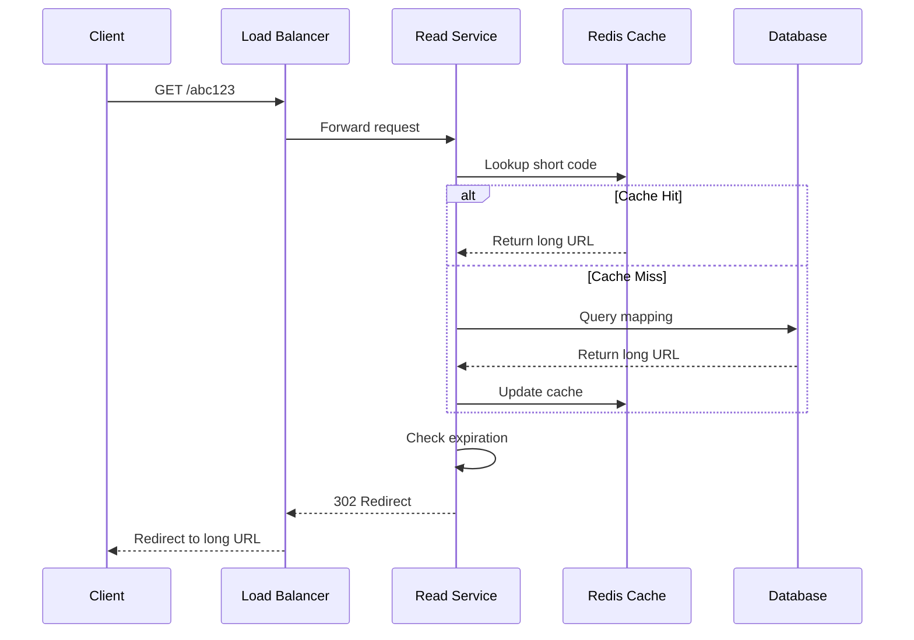
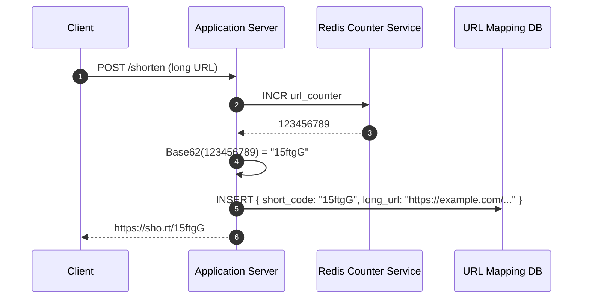

## 1. Core APIs

**Authentication:** Management endpoints (`POST /api/v1/shorten`, `GET /api/v1/analytics/...`, `GET /api/v1/users/...`) require an API key in the `X-Api-Key` header. The caller's `user_id` is derived from the key. The redirect endpoint (`GET /{short_code}`) is public and unversioned.

### 1.1 Create Short URL

**Endpoint:** `POST /api/v1/shorten`

This endpoint takes a long URL (and optional parameters) and generates a corresponding short URL.

#### Sample Request

```json
{
  "long_url": "https://example.com/very/long/url/that/needs/shortening",
  "custom_alias": "",
  "expires_at": "2024-12-31T23:59:59Z"
}
```

- `long_url` (required): The original URL that needs shortening. Must be an absolute `http`/`https` URL (max 2048 chars) and must not point at the short domain itself.
- `custom_alias` (optional): A user-defined alias for the short link (e.g., `/my-link`). If provided, the system validates uniqueness. Aliases are **case-sensitive** (`Summer-Sale` and `summer-sale` are different codes), like generated Base62 codes.
- `expires_at` (optional): Timestamp when the short link should expire. If omitted, a configurable **default TTL of 1 year** applies. If provided, it must be in the future and no more than ~20 years ahead (Cassandra's maximum TTL, minus the expiry grace period); otherwise `400`.
- `user_id` is **not** accepted in the body; it is derived from the API key so callers can't create links on behalf of other users.

#### Sample Response

`201 Created`

```json
{
  "short_url": "https://trysmartly.co/abC123",
  "long_url": "https://example.com/very/long/url/that/needs/shortening",
  "expires_at": "2024-12-31T23:59:59Z",
  "created_at": "2024-08-10T10:30:00Z"
}
```

- `short_url`: The shortened link generated by the system.
- `long_url`: The original URL.
- `expires_at`: The expiration timestamp (if set).
- `created_at`: When the short link was created.

#### Error Cases

- **409 Conflict:** If a custom alias already exists.
- **400 Bad Request:** If the URL or custom alias is invalid.
- **401 Unauthorized:** If the API key is missing or invalid.
- **429 Too Many Requests:** If the per-API-key rate limit is exceeded.

### 1.2 Redirect to Long URL

**Endpoint:** `GET /{short_code}`

This endpoint takes the short URL key and redirects the user to the corresponding long URL.

#### Sample Response

```http
HTTP/1.1 302 Found
Location: https://www.example.com/some/very/long/url
```

- **302 Found:** Default. The browser contacts the service on every click, which preserves click tracking and lets us update or expire links.
- **301 Moved Permanently:** Optional, for links that never change. It is faster on repeat visits, but the browser caches the destination and stops contacting the service, so click tracking is lost.

#### Behavior

- If the short URL exists and is active, return an HTTP redirect.
- If the link has expired, return `410 Gone`.
- If the link does not exist, return `404 Not Found`.

### 1.3 Get URL Analytics

**Endpoint:** `GET /api/v1/analytics/{short_code}`

Retrieves click statistics for a short URL. Only the link owner may access it (`403 Forbidden` otherwise, `404 Not Found` if the code doesn't exist).

#### Sample Response

```json
{
  "short_code": "abc123",
  "total_clicks": 15420,
  "created_at": "2025-01-15T10:30:00Z",
  "last_accessed": "2025-01-20T14:22:00Z"
}
```

Click counts are eventually consistent; they lag real time by up to one flush interval (see 4.5).

### 1.4 List User URLs

**Endpoint:** `GET /api/v1/users/{user_id}/urls?page_size=50&page_token=...`

Lists the links created by a user, newest first. The caller's API key must belong to `user_id` (`403 Forbidden` otherwise).

#### Sample Response

```json
{
  "items": [
    {
      "short_code": "abc123",
      "long_url": "https://example.com/very/long/url/that/needs/shortening",
      "created_at": "2025-01-15T10:30:00Z",
      "expires_at": "2026-01-15T10:30:00Z"
    }
  ],
  "next_page_token": "AAEAAA..."
}
```

## 2. High-Level Design

At a high level, our system must satisfy two core requirements:

- **URL Shortening:** Users should be able to submit a long URL and receive a shortened version.
- **Redirection:** When users access the short URL, they should be redirected to the original long URL.

Since the system has a 100:1 read-to-write ratio (1 billion reads vs. 10 million writes daily), we should design the read path (redirects) to be extremely optimized. We will separate the write service from the read service so each can scale independently.

Each request creates a new short code: shortening the same long URL twice (even by the same user) returns two different codes.

A load balancer (Nginx reverse proxy) is the single entry point. It routes `/api/v1/*` to the Shortener API and everything else (`/{short_code}`) to the Redirector API, balancing across scaled instances.

The full system diagram and the service responsibilities live in [architecture.md](architecture.md). In short: Nginx is the only public address, the Shortener and Redirector APIs are stateless, and Redis and Cassandra hold all state.

### 2.1 Requirement 1: URL Shortening



### 2.2 Requirement 2: URL Redirection



## 3. Database Design

### 3.1 SQL vs NoSQL

To choose the right database for our needs, let's consider some factors that can affect our choice:

- We need to store billions of records.
- Most database operations are simple key-value lookups.
- Read queries are much higher than write queries.
- We don't need joins between tables.
- Database needs to be highly scalable and available.

Given these points, a NoSQL database like DynamoDB or Cassandra is a better option due to their ability to efficiently handle billions of simple key-value lookups and provide high scalability and availability. We use **Apache Cassandra**.


### 3.2 Database Schema

Even though our system is simple, we should carefully design the schema to support both redirection and user management. Cassandra is modelled query-first: each access pattern gets its own table, and data is denormalized across tables instead of relying on secondary indexes or joins.

#### 1. URL Mappings Table (`url_mappings`)

Stores the relationship between a short code and its corresponding long URL. Used by the redirect path.

| Field | Type | Description |
|---|---|---|
| `short_code` | text (PK) | Unique identifier, partition key |
| `long_url` | text | Original destination URL |
| `user_id` | text | Creator's user ID |
| `created_at` | timestamp | When the link was created |
| `expires_at` | timestamp | When the link expires (always set; default 1 year) |
| `is_custom` | boolean | Whether this is a custom alias |

Rows with an expiry are written `USING TTL` (see 4.4). `click_count` is **not** stored here because Cassandra doesn't allow counter columns alongside regular columns.

#### 2. URLs by User Table (`urls_by_user`)

Replaces a secondary index on `user_id`; supports listing a user's links.

| Field | Type | Description |
|---|---|---|
| `user_id` | text (partition key) | Owner |
| `created_at` | timestamp (clustering, DESC) | Newest first |
| `short_code` | text (clustering) | Tie-breaker |
| `long_url` | text | Original destination URL |
| `expires_at` | timestamp | When the link expires |

Written together with `url_mappings` (same TTL).

#### 3. Click Counts Table (`url_clicks`)

| Field | Type | Description |
|---|---|---|
| `short_code` | text (PK) | Short code |
| `click_count` | counter | Number of redirects |

#### 4. Last Access Table (`url_last_access`)

| Field | Type | Description |
|---|---|---|
| `short_code` | text (PK) | Short code |
| `last_accessed` | timestamp | Most recent redirect |

#### 5. Users Table (`users`)

Stores user-related information for personalization, analytics, and management.

| Field | Type | Description |
|---|---|---|
| `user_id` | text (PK) | Unique user identifier |
| `email` | text | User's email address |
| `created_at` | timestamp | Account creation date |

#### 6. Users by API Key Table (`users_by_api_key`)

Authentication lookup. Only a SHA-256 hash of the API key is stored, never the raw key.

| Field | Type | Description |
|---|---|---|
| `api_key_hash` | text (PK) | SHA-256 of the API key |
| `user_id` | text | Owner of the key |

#### 7. ID Counter Checkpoint Table (`id_counter_checkpoint`)

| Field | Type | Description |
|---|---|---|
| `name` | text (PK) | Counter name (e.g. `short_code`) |
| `value` | bigint | Last known Redis counter high-water mark |

Used to re-seed the Redis counter if it is lost (see 4.1).

## 4. Design Deep Dive

Now that we have the high-level architecture and database schema in place, let’s dive deeper into some critical design choices.

### 4.1 Unique URL Generation

The short code generation strategy is one of the most critical aspects of a URL shortener. A good algorithm should produce codes that are unique (no collisions between different URLs), compact (small enough to keep the short link truly "short"), efficient (generated quickly without bottlenecks), and scalable (working across distributed servers).

#### Approach 1: Global Counter (Non-Deterministic)

This is one of the simplest and most reliable ways to generate short URLs.

Instead of hashing, it relies on a global, monotonically increasing counter to ensure every short code is unique by design.

##### How It Works

The entire system revolves around a centralized counter service that generates the next available integer ID in sequence and never repeats it.

**1. Request a Unique ID**

When an application server receives a request to shorten a URL, it contacts a Counter Service typically implemented with a fast in-memory data store like Redis, etcd, or Zookeeper.

Redis provides the `INCR` command, which is atomic by nature.

Each time this command is called, Redis locks the key, increments its value by one, returns the new value, and releases the lock. This atomicity ensures that even under heavy concurrency, no two servers ever get the same number.

**2. Encode the ID**

The application server receives the unique integer ID (e.g., 123456789) from the counter service. It then applies Base62 encoding to this number to create the final, compact short code.

##### Example Growth

- ID 1,000 -> Base62 `g8`
- ID 1,000,000 -> Base62 `4c92`
- ID 1,000,000,000 -> Base62 `15FTGg`

Even after generating a billion short URLs, the code length stays under 6-7 characters, which is extremely efficient.

##### End-to-End Example

Putting the steps together, the sequence below shows a client submitting a long URL, the application server calling Redis `INCR` to get a unique integer, encoding it to Base62, and persisting the mapping before returning the finished short URL:



##### Pros

- **Guaranteed Uniqueness:** Each ID is globally unique. No collision detection or retry logic needed.
- **Simplicity and Speed:** Just one operation (`INCR`) per short URL. Sub-millisecond latency in Redis or etcd.
- **Deterministic Length:** Short codes grow logarithmically with the total number of URLs.

##### Cons

- **Centralized Bottleneck:** Every URL creation request must pass through the counter service. Throughput is limited by the counter’s network and CPU capacity.
- **Single Point of Failure (SPOF):** If the counter service (Redis, etc.) crashes, no new URLs can be generated. The read path (redirection) still works, but the write path halts.
- **Predictability:** Since IDs are sequential, they can be easily guessed or decoded. A malicious user could increment IDs to discover private short links.

##### Addressing the Limitations

**ID Obfuscation**

To prevent sequential IDs from being easily decoded shuffle bits using a simple Feistel cipher or XOR mask.

The transformation is reversible (so you can still decode IDs if needed). This produces short codes that appear random even though they are derived from sequential IDs.

| Raw ID | Obfuscated ID | Base62  |
| ------ | ------------- | ------- |
| 1001   | 934023        | `Dgf7K` |
| 1002   | 701293        | `xAq2B` |
| 1003   | 442901        | `Kf2Tz` |

This adds privacy without sacrificing performance.

The Feistel permutation runs over a fixed **40-bit domain** (~1.1 trillion IDs), so every obfuscated value fits in at most 7 Base62 characters. At 3.65 billion URLs/year, that lasts roughly 300 years.

**Counter Durability**

To prevent duplicate codes if the Redis counter is lost or reset:

1. Redis runs with AOF persistence (`appendonly yes`, `appendfsync everysec`).
2. The current counter value is periodically checkpointed to Cassandra (`id_counter_checkpoint`). On startup, if the Redis counter is missing or lower than the checkpoint, it is re-seeded to `checkpoint + safety gap` (e.g. +100,000).
3. Every insert uses `IF NOT EXISTS`; if a generated code is already taken, a new ID is fetched and the insert is retried (bounded attempts).

### 4.2 Fast URL Redirections

The redirection service is the most performance-critical component of a URL shortener.

Every time a user clicks a short link, this service must:

1. Resolve the short code into the original long URL.
2. Redirect the user as fast as possible.

Even tiny delays (a few milliseconds) can degrade user experience at scale, especially when serving billions of redirects per day.

#### Choosing the Right Redirect Code

Before optimizing performance, we must decide how to perform the redirect.

The choice between 301, 302, and 307 affects both speed and control.

##### 301 vs. 302 Redirects

**301 (Moved Permanently)**

A 301 redirect tells browsers to permanently caches the redirect. Future clicks on the same short link will go directly to the long URL without contacting your service again.

- **Pros:** Fastest for the end-user after the first visit. Reduces load on your service significantly.
- **Cons:** You lose all control and analytics. You can no longer update the destination URL or count subsequent clicks, as the browser bypasses you completely.
- **Best for:** Links that should never change (e.g., permanent marketing URLs).

**302/307 (Temporary Redirect)**

A 302 Found or 307 Temporary Redirect tells the browser that the destination might change in the future. The browser contacts your service on every click to resolve the short code.

- **Pros:** Accurate click tracking and analytics. You can update or expire short links anytime.
- **Cons:** Slightly higher latency (each request hits your service). Adds read load to your infrastructure.

##### Recommendation

Use 302 by default. It provides flexibility, analytics, and updatability, critical for any modern URL shortener.

#### The Read Path

To achieve low latency globally, we design a "waterfall" lookup path. The system tries to find the long URL in the fastest, closest cache available. It only proceeds to the next, slower layer on a cache miss.

##### Layer 1: Browser Cache

If a 301 redirect was previously issued, the browser already knows the final URL. The request never reaches your servers, the user is instantly redirected.

##### Layer 2: CDN / Edge Cache

For global services, a Content Delivery Network (CDN) is essential. CDNs like Cloudflare, Akamai, or Fastly maintain edge servers near users worldwide.

- **Cache Hit:** The CDN instantly serves the cached 302 response with the long URL (≈10-50 ms latency).
- **Cache Miss:** The CDN forwards the request to your origin server.

##### Layer 3: In-Memory Cache (Redis/Memcached)

At your application layer, the first lookup happens in a distributed in-memory cache, keyed by the short code (e.g., `xyz`) with the long URL as the value.

- **Cache Hit:** The application server immediately returns the long URL. The CDN then caches this response for future users (cache-aside pattern).
- **Cache Miss:** If not found in Redis, the application proceeds to the final layer, the database.

##### Layer 4: Database (Source of Truth)

The database holds the authoritative mapping of short codes to long URLs. Since lookups are simple key-value reads, NoSQL stores like DynamoDB, Cassandra, or ScyllaDB are ideal.

Query Example:

```sql
SELECT long_url, expires_at FROM url_mappings WHERE short_code = 'xyz';
```

Once retrieved:

1. The app writes the result to Redis (with a TTL of `min(remaining_lifetime, 24 hours)`).
2. The next lookup will hit Redis instead of the database.
3. The app returns the 302 response with `Cache-Control: public, max-age=<min(remaining_lifetime, short default)>`, which a CDN may cache. The max-age is kept short so click tracking stays reasonably accurate.

If Redis is unavailable, the redirector falls back to Cassandra directly so redirects keep working.

> **v1 scope:** The CDN layer is out of scope; the service only emits correct `Cache-Control` headers. All redirects use `302`.

### 4.3 Supporting Custom Aliases

Custom aliases allow users to create human-readable short codes instead of system-generated ones.

For example:

This feature is especially valuable for marketing campaigns, social media sharing, and brand consistency, where memorability and aesthetics matter.

However, supporting custom aliases introduces challenges around validation, uniqueness, and race conditions that must be carefully handled to maintain system integrity.

#### 1. API Design

The API for link creation should accept an optional `custom_alias` parameter along with the long URL.

```json
{
  "long_url": "https://www.my-ecommerce-store.com/products/summer-collection-2025",
  "custom_alias": "summer-sale",
  "expires_at": "2025-09-01T23:59:59Z"
}
```

If the `custom_alias` field is not provided, the service falls back to auto-generating a short code using the ID generation algorithm.

#### 2. Rigorous Validation

Before creating a custom alias, the system must validate it against strict rules to prevent conflicts, misuse, or routing errors.

- **Character Set:** The alias must only contain URL-safe characters. A regular expression like `^[a-zA-Z0-9_-]+$` is typically used to enforce this.
- **Length Limits:** Enforce minimum and maximum lengths (e.g., 3-50 characters) to prevent abuse and maintain usability.
- **Reserved Words:** The system must check the alias against a blocklist of reserved words. This list should include application routes (`/api`, `/admin`, `/login`), common terms (`/help`, `/contact`), and any potentially offensive words. This prevents users from hijacking critical application paths.

All checks should occur before any database operation to minimize load on backend systems.

#### 3. Ensuring Uniqueness and Handling Race Conditions

This is the most critical aspect of custom alias creation.

##### The Race Condition Problem

Two users could try to claim the same custom alias (`summer-sale`) at the exact same moment.

1. User A's request checks if `summer-sale` exists. (It doesn't).
2. User B's request checks if `summer-sale` exists. (It still doesn't).
3. User A's request inserts the record. (Success).
4. User B's request tries to insert the record. (This will either fail or create a duplicate, depending on the database schema).

Without proper safeguards, both requests might initially think the alias is free leading to duplicate entries or inconsistent state.

##### The Reliable Solution

Instead of a separate "check, then write" in application code, push the uniqueness guarantee down to the storage layer with a single atomic conditional write that only succeeds if the key does not already exist.

The custom alias occupies the same key space as generated short codes (it is stored as the `short_code`), so a redirect resolves both kinds of code the same way.

The exact primitive depends on the store:

- **Cassandra:** `INSERT ... IF NOT EXISTS`, a lightweight transaction.

Example (cassandra conditional write):

```python
# Only succeeds if the short code (alias) is not already taken
result = session.execute(
    """
    INSERT INTO url_mappings (short_code, long_url, is_custom)
    VALUES (%s, %s, %s)
    IF NOT EXISTS
    """,
    ("summer-sale", "https://www.my-ecommerce-store.com/products/summer-collection-2025", True),
)

if not result.was_applied:
    # Alias already taken -> 409 Conflict
    ...
```

If the conditional write fails because the key is taken, the service returns `409 Conflict` for a custom alias, or generates a new code and retries for an auto-generated one.

### 4.4 Supporting Link Expiration

Link expiration is essential for maintaining both security and data hygiene.

It is common in time-sensitive campaigns such as marketing or event promotions, security-critical links like password resets or invitations, and routine system maintenance to prevent indefinite data growth.

Without proper expiration handling, a URL shortener’s database could grow endlessly, degrading performance and increasing storage costs.

#### 1. Recommended Hybrid Approach

A hybrid strategy combines the precision of passive expiration with the efficiency of occasional cleanup.

**Step 1: Passive Expiration for Read Path**

Every redirect request performs a real-time expiration check, so users experience instant and accurate expiration behavior.

**Step 2: Lazy Cleanup for Data Hygiene**

Instead of a background cleanup job, rows are written with Cassandra's native TTL: `USING TTL` = seconds until `expires_at` **+ a grace period** (e.g. 30 days). During the grace window the row still exists, so the redirector can return `410 Gone`; after Cassandra purges it, the code returns `404 Not Found`. This prevents unbounded growth without adding continuous load to the database.

Counter tables (`url_clicks`) don't support TTL; their orphaned rows are accepted for v1.

> Cassandra 5.0 rejects TTLs that expire after 2038 unless `storage_compatibility_mode` is `NONE`; the maximum TTL is 20 years (630,720,000 s).

#### 2. Caching and Expiration Consistency

A crucial design consideration is ensuring all cache layers respect link expiration.

If not handled carefully, caches might continue serving redirects after the link has expired.

##### Problem Example

Suppose a link expires in 5 minutes (300 seconds), but its CDN or Redis cache entry is set with a TTL of 24 hours. Even after the link expires, cached redirects keep getting served, which violates user expectations and can create security risks.

##### Solution

When writing to any cache, set the cache TTL to the smaller of:

```
TTL_cache = min(link.remaining_lifetime, default_cache_ttl)
```

This ensures cache TTLs align with link lifetimes to prevent expired redirects from being served.

### 4.5 Analytics: Click Count

A modern URL shortening system is not complete without analytics. The most fundamental metric is click count, the number of times each shortened link is accessed.

This data powers insights such as how many people clicked a link, which campaigns perform best, and where and when traffic originates.

However, counting clicks accurately at scale introduces challenges related to performance, consistency, and real-time aggregation.

#### What Is a "Click"?

A click is registered whenever a user follows a shortened link that results in a successful redirect to the target URL.

To prevent double counting, a few conditions are typically applied: only HTTP 302/301 redirects count, requests that result in expired, invalid, or bot traffic are excluded, and repeated requests from the same user within a short time window may be ignored.

> **v1 scope:** Every successful `302` redirect counts as a click. Bot filtering and per-user de-duplication are deferred; `404`/`410` responses are never counted.

#### Click Logging Flow

When a user clicks a short link, two things happen simultaneously:

1. The user must be redirected instantly (performance-critical).
2. The system must record the click for analytics (accuracy-critical).

To avoid slowing down the redirect path, these actions are separated into synchronous and asynchronous operations.

This decoupled design ensures the redirect latency remains low while analytics are processed asynchronously.

#### Approach 1: Buffered Counting (Recommended for Scale)

For high-traffic systems, direct increments are inefficient. Instead, accumulate clicks in memory or a fast cache and flush them periodically to the database.

**Workflow**

1. When a user clicks a link, the redirector increments a counter in Redis, marks the code as dirty and records the access time:

   ```
   INCR clicks:abc123
   SADD clicks:dirty abc123
   SET last:abc123 <timestamp>
   ```

2. The Analytics Worker periodically (e.g. every 10s) pops dirty codes with `SPOP clicks:dirty <batch>` and atomically reads-and-resets each counter with `GETDEL clicks:abc123` / `GETDEL last:abc123`.

3. It then updates the persistent store:

   ```sql
   UPDATE url_clicks
   SET click_count = click_count + :redis_count
   WHERE short_code = 'abc123';

   UPDATE url_last_access
   SET last_accessed = :last
   WHERE short_code = 'abc123';
   ```

4. If the Cassandra write fails, the count is added back to Redis (`INCRBY`) and the code is re-added to `clicks:dirty`.

##### Pros

- Significantly reduces database writes.
- Handles high concurrency efficiently.
- Redis operations are atomic and fast.

##### Cons

- Counts in the UI may lag slightly behind real time (depending on flush interval).
- Cassandra counter updates aren't idempotent, so a worker crash between `GETDEL` and the Cassandra write can lose (or, on retry, double-count) a small number of clicks.
