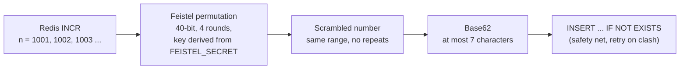
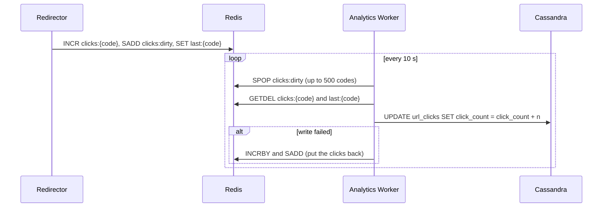

# Technical Decisions: the "why"

[tech-stack.md](tech-stack.md) lists *what* the system is built with. This page records *why*, each decision with a one-line reason first, then the evidence behind it and the cost we accepted. Numbers come from [requirements.md](../01-requirements/requirements.md) and from the measurements in the [implementation plan](../03-implementation/implementation-plan.md) (Phase 11).

| # | Decision | One-line reason |
|---|---|---|
| 1 | Cassandra as the database | Our workload is key lookups at 100:1 reads, 5.5 TB and TTLs, which is what a partitioned wide-column store does best. |
| 2 | Denormalized, one-table-per-query schema | Cassandra has no joins, so every question we ask gets a table that answers it with a single partition read. |
| 3 | Redis next to Cassandra | Memory-speed reads keep p99 under 50 ms, and its atomic commands give us a lock-free counter and a click buffer. |
| 4 | Counter, then Feistel, then Base62 | Uniqueness comes from the counter, unguessability from a keyed permutation, and `IF NOT EXISTS` is the safety net. |
| 5 | Redis `INCR` for IDs, buffered click flush | One atomic increment per link, and one batched write per flush interval instead of one per click. |
| 6 | Nginx as the only entry point | One public address that splits reads from writes so each side scales on its own. |
| 7 | API keys, stored hashed | The simplest authentication that is still safe for machine callers, with no identity provider needed. |
| 8 | OpenTelemetry + Grafana stack | A latency target we cannot measure is a target we cannot keep, and several failures are silent by design. |

---

## 1. Why Cassandra over other databases

**Because the data pattern is "look up one row by key, billions of times, and never join".**

| What the data looks like | What that asks of the database | Where Cassandra answers it |
|---|---|---|
| 1 billion reads vs 10 million writes a day (100:1), all `short_code -> long_url` | O(1) point lookup, no scans | `short_code` is the partition key: one node, one read |
| About 3.65 billion rows a year, about 5.5 TB over 5 years | Spread data over many machines without resharding by hand | Consistent-hash partitioning, add nodes to grow |
| Links expire (default 1 year, plus a 30-day grace) | Automatic cleanup, no sweeper job | Native per-row `USING TTL` |
| A mapping must never be lost and two links must never share a code | Durable writes and an atomic "insert only if absent" | Replicated commit log, and lightweight transaction `INSERT ... IF NOT EXISTS` |
| Click counts updated concurrently from many places | Increment without read-modify-write races | Counter tables |
| 99.99% availability goal | No single point of failure in the data tier | Masterless, multi-node replication |

Why not the alternatives:

- **PostgreSQL / MySQL:** we use none of their strengths (joins, multi-row transactions) and would pay for hand-rolled sharding at this size.
- **MongoDB / DynamoDB:** both would work for the access pattern, but Cassandra is open source and runs in Docker Compose on a laptop, while DynamoDB ties us to one cloud.
- **Redis as the primary store:** 5.5 TB in RAM is the wrong cost, and its durability is weaker than a replicated commit log.

*Cost we accepted:* LWT writes are slower than plain writes, which is fine because they happen only on the write path (about 115 per second, 350 at peak), never on a redirect. v1 runs a single node; the multi-node benefits are designed for but not demonstrated.

## 2. Why denormalized tables on Cassandra

**Because Cassandra is modelled query-first: no joins and no cheap secondary indexes, so each question gets its own table.**

| Question the system asks | Table | Why it is shaped this way |
|---|---|---|
| Where does this code redirect? | `url_mappings` (partition key `short_code`) | The hot path: one partition read |
| List a user's links, newest first | `urls_by_user` (partition `user_id`, clustering `created_at DESC`) | A secondary index on `user_id` would fan out across the cluster; a clustering order gives "newest first" and paging for free |
| How many clicks? | `url_clicks` (counter) | A counter column cannot sit beside normal columns, so it needs its own table |
| When was it last used? | `url_last_access` | Kept apart from the counter table, which can hold nothing but counters |
| Which user owns this API key? | `users_by_api_key` (key hash) | Authentication looks up by key, not by user |
| Where did the ID counter get to? | `id_counter_checkpoint` | Lets us rebuild the Redis counter after a loss (see 5) |

*Cost we accepted:* one create writes two tables (`url_mappings` and `urls_by_user`, with the same TTL), so a write is a bit heavier and the two copies must be kept in step. That is the right trade at a 100:1 read-to-write ratio: pay a little on the rare write to keep every read to one partition.

## 3. Why Redis

**Because the redirect target of under 50 ms (p99) needs memory-speed lookups, and Redis also gives us three atomic tools we would otherwise have to build.**

| Job | Redis feature | Why it is the right tool |
|---|---|---|
| Read cache for redirects | `GET`/`SET` with a TTL of `min(remaining lifetime, 24 h)` | A cache hit never touches Cassandra; the TTL rule means an expired link is never served from cache. Measured: 97% hit ratio, p50 3.4 ms |
| Unique ID counter | `INCR` | Atomic and single-threaded, so concurrent servers can never receive the same number, and there are no locks to manage |
| Click buffer | `INCR`, `SADD`, `GETDEL`, `SPOP` | Absorbs thousands of clicks and lets one worker write them to Cassandra in batches |

Why not Memcached: it has no atomic read-and-delete, no sets and no persistence, which rules out the counter and the buffer.

*Cost we accepted:* Redis is a dependency of the write path (shortening returns `503` without it) but **not** of the read path: the redirector falls back to Cassandra with fast-fail connection settings, so redirects keep working with Redis down (tested by the `RedisOutage` scenario).

## 4. How we get a unique short code (and hide the counter)

**Uniqueness comes from the counter, which never repeats; the Feistel step only hides it.**

- **Why a counter and not a hash of the URL:** hashes collide and give the same code for the same URL, but we want every request to get a fresh code with no collision handling.
- **Why obfuscate:** sequential codes (`...1001`, `...1002`) let anyone enumerate other people's links.
- **Why Feistel specifically:** it is a *permutation*, meaning every input maps to a different output, so scrambling can never create a collision, unlike random or hashed IDs. It is also keyed (secret from SHA-256 of `FEISTEL_SECRET`) and reversible.
- **Why 40 bits:** about 1.1 trillion IDs fits in at most 7 Base62 characters (62^7 is about 3.5 trillion), and at 3.65 billion links a year that lasts roughly 300 years.
- **Safety net:** every insert uses `IF NOT EXISTS`; if a code is somehow taken, a new ID is fetched and the insert retried (bounded). Custom aliases use the same conditional insert, so a clash returns `409`.
- Measured: 400 links from 5 users gave 400 distinct codes, 376 with 7 characters and 24 with 6 (Base62 has no padding), never longer.

*Cost we accepted:* the secret must stay constant for the life of the data; changing it later could make new codes collide with old ones.

## 5. The ID counter with Redis `INCR`, and how clicks are flushed

**One atomic increment per new link, and one batched write per interval instead of one write per click.**

### 5.1 ID counter

- `INCR id:counter` returns the next number atomically; that is the whole generator.
- Losing the counter would re-issue old numbers, so it is protected three ways: Redis runs with AOF (`appendfsync everysec`); the worker saves a **checkpoint** to Cassandra every 30 s; and on startup, if Redis is behind the checkpoint, the counter is re-seeded to `checkpoint + 100,000`.
- The gap only has to exceed the IDs handed out between checkpoints (30 s at the 350 per second peak is about 10,500), so it is generous. Verified in the `CounterReseed` scenario: after deleting the counter it came back at 100,136 instead of 126.

### 5.2 Click flush

- **Why buffer:** the redirect must stay fast, so it does three cheap Redis writes in one round trip and Cassandra is touched only by the worker.
- **Why `GETDEL`:** it reads and removes in one step, so a click that arrives mid-flush starts a fresh counter instead of being lost.
- **Why the dirty set:** the worker only visits links that changed, not every link.
- **If Cassandra is down:** the counts are put back in Redis and retried next cycle; verified that an outage lost nothing.

*Cost we accepted:* a Cassandra counter update cannot be safely repeated, so a worker killed between `GETDEL` and the write loses those clicks, and a write that succeeds but reports a timeout is counted twice on retry. Counts are therefore "at least once, almost exactly once", and they lag real time by up to one flush interval.

## 6. Why Nginx

**Because we want one public address that sends writes and reads to different services, so each side can scale on its own.**

- **Path-based routing:** `/api/v1/*` goes to the Shortener, everything else to the Redirector. The two services have a 100:1 load difference, so they must scale independently (we ran 3 redirector replicas behind it).
- **Resilience:** with one of three replicas stopped, 300 of 300 redirects still succeeded, because Nginx retries another replica.
- **Scaling without reconfiguration:** upstream names are re-resolved through Docker DNS every few seconds, so `--scale redirector-api=3` just works.
- **Keeps services private:** only Nginx publishes a port, and it sets `X-Forwarded-For` from the real connecting address (never the caller's own header), so rate limiting and logs see the true client and cannot be spoofed.
- **Cheap defence:** a 16 KB body limit is enforced before a request reaches the services.
- **Why not an API gateway or a cloud load balancer:** more moving parts than this system needs, and Nginx runs identically on a laptop and in CI.

*Cost we accepted:* a single Nginx container is itself a single point of failure and has no TLS in v1; production would put several behind a cloud load balancer.

## 7. Why API keys for authentication

**Because this is a machine-to-machine API with no sign-up screen, and a hashed random key is the simplest scheme that is still safe.**

- **Who is calling is derived from the key:** `user_id` is never accepted from the request body, so one user cannot create or read links as another (checked by the `Auth` scenario: `401`, `401`, `403`, `403`).
- **Only a hash is stored:** a SHA-256 of the key sits in `users_by_api_key`, so a database leak does not expose usable keys. A fast hash is enough because the keys are 256-bit random values, unlike human passwords.
- **Revocation is trivial:** delete the row.
- **Pairs with rate limiting:** each user gets a token bucket of 100 requests a minute on link creation; unauthenticated requests share a bucket per client address so key guessing is throttled too.
- **The redirect endpoint stays public**, because anyone must be able to follow a short link.
- **Why not OAuth or JWT:** they need an identity provider and token lifecycle that v1 explicitly leaves out (no sign-up, no key management endpoints).

*Cost we accepted:* each authenticated call is one Cassandra read (no key cache yet), and the key travels in a header, so production needs TLS.

## 8. Why observability, and the custom metrics we expose

**Because the "p99 under 50 ms" requirement is only real if we can measure it, and several failures are silent by design.**

Examples of silent behaviour that needs a signal: a Redis outage degrades redirects to Cassandra without any error, and a failed click flush quietly retries. Without metrics both look like "everything is fine".

How it is built: services emit OpenTelemetry traces, metrics and logs to a collector, which feeds Tempo (traces), Prometheus (metrics) and Loki (logs), viewed in Grafana. It is opt-in: nothing is exported unless `OTEL_EXPORTER_OTLP_ENDPOINT` is set. Health endpoints (`/health/live`, `/health/ready`) cover the container and load-balancer checks.

### Custom metrics

All five come from one meter named `UrlShortener`. Prometheus shows them with dots replaced by underscores and `_total` added.

| Metric (Prometheus name) | Tag values | Question it answers |
|---|---|---|
| `urlshortener.redirects` (`urlshortener_redirects_total`) | `result` = `found`, `not_found`, `expired`, `invalid_code` | How much redirect traffic is real, and how much is misses, expired links or junk paths? |
| `urlshortener.cache.lookups` (`urlshortener_cache_lookups_total`) | `result` = `hit`, `miss` (a miss also covers an unreachable cache) | What is the cache hit ratio, and did Redis just go away? |
| `urlshortener.shorten.requests` (`urlshortener_shorten_requests_total`) | `outcome` = `created`, `invalid`, `alias_taken`, `generation_failed` | Are users failing validation or colliding on aliases, and is code generation struggling? |
| `urlshortener.clicks.flushed` (`urlshortener_clicks_flushed_total`) | none | Is the worker moving clicks from Redis into Cassandra? |
| `urlshortener.clicks.flush.failures` (`urlshortener_clicks_flush_failures_total`) | none | Are clicks being put back because Cassandra is failing? |

On top of these come the framework metrics (request duration histograms per route, runtime counters) that give the p50, p95 and p99 redirect latency, and custom trace spans (`cache.get`, `cassandra.execute`, `clicks.record`) that show where the time of one redirect goes. The Grafana dashboard "URL Shortener" charts redirect p99, cache hit ratio and error rates.

*Cost we accepted:* five extra containers for the full stack, which is why it is an optional compose profile rather than part of the default start.
