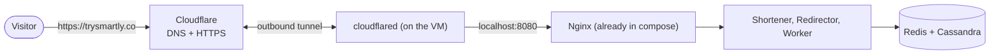

# Hosting Guide: Putting It Live

How I would walk a junior engineer through hosting this as a public showcase: a free Oracle VM, the `trysmartly.co` domain, and a Cloudflare Tunnel for HTTPS. The only cost is the domain (about $10-30 a year).

## The big picture



The VM **dials out** to Cloudflare, so we open no web ports on it at all. No certificates to manage and no public IP to attack.

## Cost

| Item | Cost |
|---|---|
| Domain `trysmartly.co` | About **$10-12 for the first year** (promo), then about **$25-35 a year** to renew. Prices vary by registrar, so compare before buying. |
| Oracle VM (Always Free) | $0 |
| Cloudflare (DNS, tunnel, HTTPS) | $0 |
| **Total** | **About $10-35 a year**, only the domain |

Turn on auto-renew, or the domain (and every short link) dies on expiry.

## Steps

### 1. Buy the domain and move DNS to Cloudflare
- Buy `trysmartly.co` at any registrar (Cloudflare, Namecheap, Porkbun).
- Create a free Cloudflare account, add the domain, and switch the registrar's nameservers to the two Cloudflare gives you. Wait until Cloudflare says the domain is active.

### 2. Create the Oracle VM (Always Free)
- Sign up at Oracle Cloud (a card is needed for verification, it is not charged on Always Free).
- Create an instance: shape **VM.Standard.A1.Flex (Ampere ARM)**, **4 OCPU and 24 GB RAM** (the free maximum), image **Ubuntu 24.04 (aarch64)**, and add your SSH public key.
- If it says "out of capacity", retry later or pick another availability domain.
- Keep the default network rules: only SSH (22) is open. Do **not** open 80, 443, 6379 or 9042.
- Upgrading the account to "Pay As You Go" stays free within the Always Free limits and stops Oracle from reclaiming a VM it thinks is idle.

### 3. Prepare the server
```bash
ssh ubuntu@<vm-public-ip>
curl -fsSL https://get.docker.com | sh
sudo usermod -aG docker $USER        # log out and back in afterwards
```
All images we use (Cassandra, Redis, Nginx, .NET) have ARM builds, so nothing changes in the compose file for that.

### 4. Get the code and configure
```bash
git clone <your repo> && cd URL_Shortener_Service/deploy
cp .env.example .env
```
Edit `.env`:
- `FEISTEL_SECRET`: long random value (`openssl rand -base64 32`). **Never change it later**, or new codes can collide with old ones. Back it up somewhere safe.
- Leave `PUBLIC_PORT=8080`.

### 5. Production settings in `docker-compose.yml`
- `shortener-api`: `Shortener__ShortUrlBase: https://trysmartly.co` (short links are built from this, and links pointing at your own domain are rejected from it).
- `redirector-api`: `Redirector__ExposeInstanceId: "false"` (dev-only debug header).
- Bind the ports to the VM itself so only the tunnel can reach them:
  - nginx: `"127.0.0.1:8080:80"`
  - cassandra: `"127.0.0.1:9042:9042"`
  - redis: `"127.0.0.1:6379:6379"`

### 6. Start the stack
```bash
docker compose up -d --build
docker compose ps                              # everything healthy?
curl -i http://localhost:8080/health/ready     # expect 200
```
The first build on the VM takes a while, and Cassandra needs about a minute to become healthy.

### 7. Set up the Cloudflare Tunnel
1. Cloudflare dashboard, then **Zero Trust**, **Networks**, **Tunnels**, **Create a tunnel**, type **Cloudflared**, name it `trysmartly`.
2. Pick **Debian / arm64** and run the install commands it shows on the VM. They install `cloudflared` as a service that starts on boot.
3. Add a **public hostname**: domain `trysmartly.co`, service type **HTTP**, URL `localhost:8080`.
4. In Cloudflare, **SSL/TLS**, **Edge Certificates**: turn on **Always Use HTTPS**.

Cloudflare creates the DNS record itself. Check `https://trysmartly.co/health/ready` returns 200.

### 8. Create the demo key (v1 has no sign-up)
- v1 has **no user creation**. Visitors use one shared **demo API key**.
- Seed it with `scripts/New-DevUser.ps1` (needs PowerShell 7 on the VM: install `pwsh` from Microsoft's apt repo). It writes the raw key to `scripts/.dev-users.json` (git-ignored); only the hash is stored in the database.
- Put the demo key in the README. Keep it low-risk for a public key:
  - Lower the rate limit: `RateLimit__TokenLimit` and `RateLimit__TokensPerPeriod` on `shortener-api`.
  - Short link lifetime: `Expiry__DefaultTtl: "7.00:00:00"` on **both** `shortener-api` and `redirector-api`.
- Rotate the key if it gets abused: delete the user and seed a new one.

### 9. Smoke test like a user
- `POST https://trysmartly.co/api/v1/shorten` with the demo key, then open the returned short link in a browser. It should `302` to the long URL.
- Run `scripts/Invoke-Scenario.ps1` against the public address, non-disruptive scenarios only. **Never** run `-IncludeDisruptive` on the live stack.

### 10. Watch it (optional)
- `docker compose --profile observability up -d`, and set `OTEL_EXPORTER_OTLP_ENDPOINT=http://otel-collector:4317` in `.env`.
- Do **not** publish Grafana (`3000`); its default login is admin/admin. Use an SSH tunnel: `ssh -L 3000:localhost:3000 ubuntu@<vm-ip>`.

### 11. Back up and update
- Containers use `restart: unless-stopped`, and Docker plus `cloudflared` start on boot, so a reboot recovers on its own.
- Back up the `cassandra-data` and `redis-data` volumes and your `.env`. The simplest option is an Oracle boot volume backup (stop the stack first for a clean copy).
- Update with `git pull && docker compose up -d --build`.

## Staying inside the free limits

Always Free is generous but not unlimited. Check Oracle's current limits page, but as of writing the ones that matter are:

| Limit | Free allowance | How we stay under it |
|---|---|---|
| Compute | 4 ARM cores, 24 GB RAM in total | One VM; do not add `--scale` beyond 2-3 redirectors |
| Disk | 200 GB of block storage in total | Short link lifetime of 7 days for the demo key; a small row count |
| Outbound traffic | About 10 TB a month | Redirects are tiny (a 302 with no body); a rate limit stops one client from flooding it |

An open public demo can still be hammered, so cap it in three places:

1. **Per-key limit (already in the app):** `RateLimit__TokenLimit` and `RateLimit__TokensPerPeriod` on `shortener-api` cap how fast the demo key can create links.
2. **Per-IP limit at the edge:** add a Cloudflare rate-limiting rule (the free plan includes one) on `/api/` and on `/*` for bursts, for example 60 requests a minute per IP. This stops abuse before it reaches the VM.
3. **Per-IP limit in Nginx (optional second layer):** behind the tunnel every request looks like it comes from `localhost`, so key it on the header Cloudflare adds:
   ```nginx
   limit_req_zone $http_cf_connecting_ip zone=perip:10m rate=20r/s;   # http level
   limit_req zone=perip burst=40 nodelay;                              # inside server { }
   ```

Three more habits keep usage down:
- Keep the 7-day default link lifetime, so the database does not grow forever.
- Keep the 16 KB request body cap that Nginx already has.
- Look at the VM's CPU and network graphs in the Oracle console once a week.

## Pre-launch checklist

- [ ] Domain active on Cloudflare; `https://trysmartly.co/health/ready` returns 200
- [ ] Oracle network only allows SSH (22); nothing else is reachable from outside
- [ ] Nginx, Cassandra and Redis bound to `127.0.0.1`
- [ ] `FEISTEL_SECRET` set, backed up, never committed
- [ ] `ShortUrlBase` is `https://trysmartly.co`; debug header off
- [ ] Demo key works, with a low rate limit and 7-day links
- [ ] Cloudflare per-IP rate-limit rule on; domain auto-renew on
- [ ] Grafana not exposed
- [ ] Backup taken, and a restore tried once

## Later, if it grows

One VM is fine for a showcase. Growing past it means separate Redis and Cassandra hosts (or managed services), a 3-node Cassandra cluster with a replication factor of 3, and the stateless services behind a load balancer. The design already supports this; only the deployment changes.
